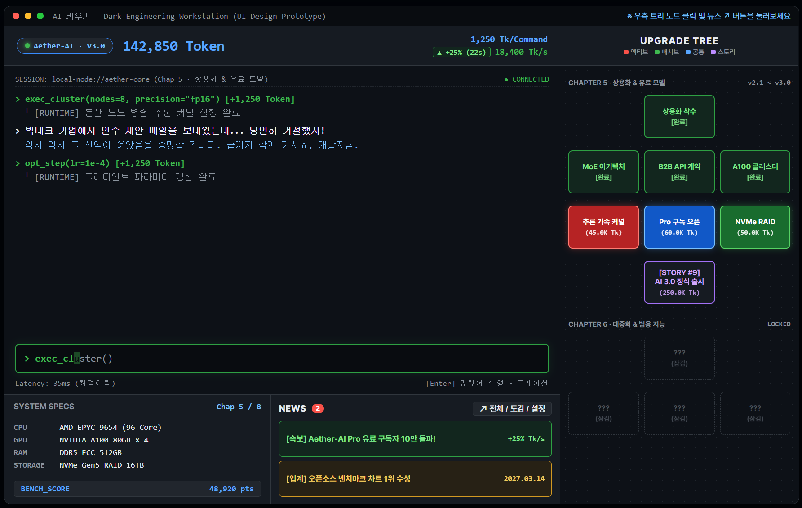

## \* 중요! *
#### 나만의 인공지능 키우기 개발노트

---

Memo(2026/11/25 10:14 추가):  
웍스 메일 받으셨겠지만, 12월 9일 보강에서 발표 일정을 더 잡으신걸로 보아 최소 12월 1일부터 발표가 시작될 것 같습니다.  
최소한 이번 주 이내에는 개발 작업을 마무리 지어야 밸런싱 작업 및 이후 보강이 원활할 것으로 보입니다.  
빠른 작업 부탁드립니다.  
\+ 내용 추가 : UI 프로토타입입니다. 트리 에러와 다른 구현 오류는 무시하셔도 됩니다.  

---

Memo(2026/11/24 21:39 추가):  
제가 할 모든 기능 작업을 마무리지었습니다.  
마지막으로 트리 구조 다듬기와 스토리 조금 더 다듬으면 코어 기능 개발 완료입니다.  
디자인 작업을 거쳐서 밸런싱 작업을 진행할 예정입니다.  
트리 이름 작업 마치시면 upgrades.json 파일 전달 부탁드립니다.  
>명령어 자동 입력 기능은 빼는게 좋아보입니다. 구현에 있어 애매하기도 하고, 액티브의 개념을 흐리는 것 같아 빼는게 좋아보입니다.  

확인하시고 아래에 수정으로 답변 부탁드립니다.  

---

Memo(2026/11/24 14:28 추가):  
tree_viewer.py에 트리 구조 수정 기능을 추가시켰습니다.  
트리 내용 및 업그레이드 항목 등등 수정을 할 수 있는 인터페이스입니다.  
같은 폴더에  data/upgrades.json 파일이 존재하여야 사용 가능합니다.  
본 파일 활용하서서 트리 구조 개선하시고 전달해주시면 감사하겠습니다.  

---

2026/11/19 기준 구현 화면

> > 수정 예정 사항 및 개발 예정 사항  
> 
> 콘솔 부분에 가상 대화 출력  
> 스토리 구현 및 트리 내용 디테일하게 수정  

---

### 프로젝트 내 파일 구조
core/ -  시스템 구성 핵심 소스코드  
data/ - 스토리, 뉴스 등 인게임 표출 데이터 저장  
ui/ - PyQt6 기반 시각화 구성  
saves/ - 실시간 세이브 파일 저장소

---

### // TimeLine //  
2026/11/15 03:40 - 프로토타입 모델 구성 및 트리 구현 완료  
2026/11/16 13:06 - 뉴스 및 도감 팝업 구성 완료  
2026/11/16 13:27 - 큰 수 표기법 개선  
2026/11/16 14:40 - 콘솔 수정  
2026/11/17 10:11 - 세이브/로드 기능 추가  
2026/11/18 19:03 - 길이 4단계 구분 명령어 총 80개 추가  
2026/11/18 19:23 - 뉴스 등장 연출 추가  
2026/11/18 19:25 - 스토리 초안 업로드  
2026/11/18 19:46 - 초안 기반 업그레이드 트리 프로토타입 구현  
2026/11/19 03:40 - 랜덤성 스토리 업로드  
2026/11/20 13:53 - 튜토리얼 구현  
2026/11/22 05:00 - AI 활동 업로드  
2026/11/22 08:53 - AI 유료 플레이어 업로드  
2026/11/22 16:05 - 엔딩 구현  
2026/11/23 15:46 - 뉴스 1~7 Chap, 각 15개씩 총 105개 업로드  
2026/11/23 23:42 - AI 활동 수정  
2026/11/24 10:29 - 뉴스 탑재 및 가시성 개편  
2026/11/24 11:01 - 트리 미리보기 (테스팅용) SW 업데이트  
2026/11/24 11:22 - 스토리 개선  
2026/11/24 14:28 - 트리 에디터 추가(개발용)  
2026/11/24 16:58 - 상시 콘솔 대화 연출 추가. 대화 리스트 210개 추가  
2026/11/24 21:39 - 도감 작업 완료, 콘솔 대화 마무리 (최종 208개)  
2026/11/25 14:03 - 세이브 미리보기 및 트리 테스트 코드 추가